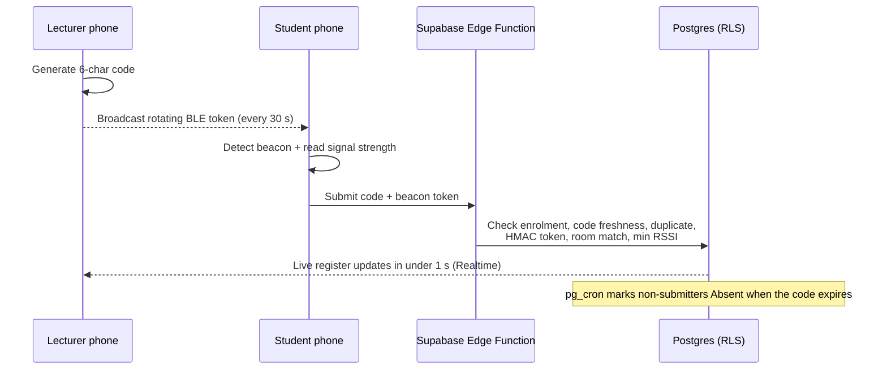

# CampusCheck

**A production attendance app that stops students from signing in for absent friends.**

QR codes, shared PINs and GPS can all be beaten from the corridor or a WhatsApp group. CampusCheck requires a student's phone to **hear a Bluetooth beacon broadcast from the lecturer's phone inside the classroom** *and* enter a short-lived 6-character code. The server checks both before it marks anyone present.

> The source code is private. This repo shows what the app does and how it's built. Code walkthroughs are available on request.

---

## How it works

## Features

**Students:** check in with code + beacon, see attendance % per module with at-risk warnings, history, absence notes and appeals, GPA tracker, a "you can safely miss N more" calculator, badges, lecturer ratings, announcements, calendar, reminders.

**Lecturers:** generate codes that start the phone beacon automatically, a live register that updates in real time, CSV export, review absence notes (including bulk review), announcements, class events.

**Admins (14 tabs):** dashboard and 12-week trends, lecturer performance, full management of students, lecturers, programmes, modules, sessions, venues, beacons and terms, CSV imports with per-row results, mass enrolment, year promotion, password resets, attendance rules.

**Everywhere:** light/dark theme, forced password change on first login, merged calendar, push notifications.

## Engineering highlights

- **Custom native Android module (Kotlin)** for BLE advertising and scanning, with a time-windowed HMAC token so a beacon can't be replayed later.
- **Security enforced in the database, not the app.** Row Level Security is on all 25 tables. Students have zero access to attendance codes, and attendance rows can only be written by a validating edge function.
- **Server-side validation chain:** auth, then enrolment, code freshness, duplicate check, beacon token, room binding and signal strength, with clear error messages for each failure.
- **Realtime across roles:** a student's check-in appears on the lecturer's register in under a second, with a polling fallback.
- **Scheduled jobs:** `pg_cron` closes expired sessions and marks absences every minute.
- **Tested:** 48 automated tests covering auth, timing windows, the API contract and post-MVP features.

## Tech stack

| Layer | Tech |
|---|---|
| Mobile | React Native 0.86, Expo SDK 57, TypeScript/JavaScript, NativeWind, Reanimated, TanStack Query |
| Native | Kotlin Expo module (Bluetooth Low Energy advertise + scan) |
| Backend | Supabase: Postgres, Auth, Row Level Security, Edge Functions (Deno), Realtime, pg_cron |
| Builds | EAS Build → signed Android APK / App Bundle |

## Screenshots

<!-- Add real screenshots to /screenshots and list them here -->
_Coming soon._

## Demo video

_Coming soon._

---

## Hire me

I build mobile apps with React Native + Supabase, from idea to Play Store.

**GitHub:** [@yaseenselemane](https://github.com/yaseenselemane)
